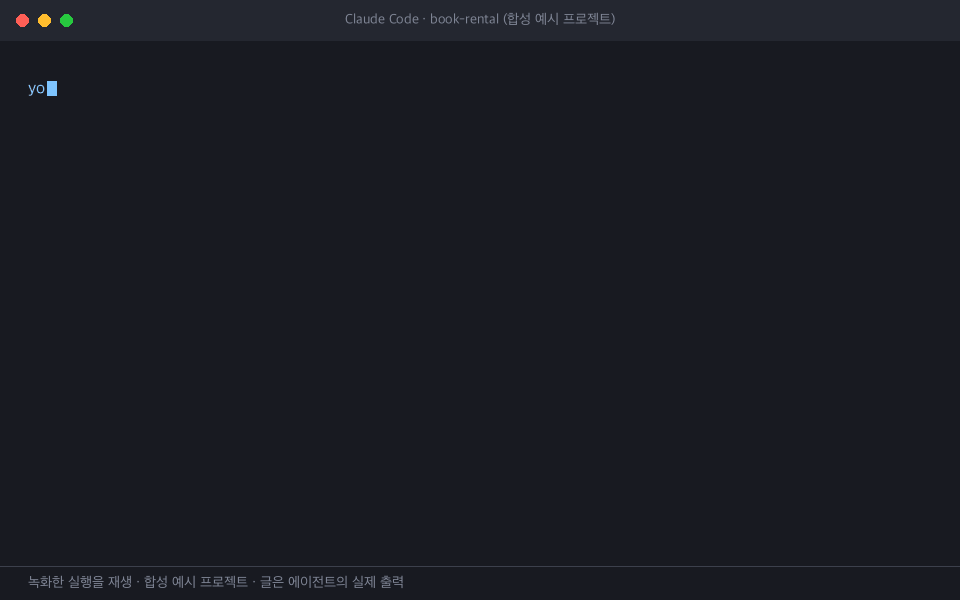

# Code Understanding Coach

**지금 프로젝트 코드**를 얼마나 이해하고 있는지 점검하는 에이전트 스킬입니다.
실제 동작에 대해 한 번에 하나씩 묻고, 답을 실제 코드와 대조해 `파일:줄` 근거로
평가하며, 놓친 부분은 다른 상황에서 다시 확인합니다.

AI 에이전트가 코드를 많이 써 준 프로젝트에서, 배포하거나 유지보수하거나 남에게
설명하기 전에 내가 실제로 무엇을 예측할 수 있는지 확인할 때 쓰면 좋습니다.

[English README](README.md)



<sub>녹화한 실행을 재생한 것입니다(Claude Code, 합성 예시 프로젝트 `tests/fixtures/book-rental`).
글은 에이전트의 실제 출력이며 표시 형식만 단순화했습니다.</sub>

## 하는 일

- **"프로젝트 이해도 점검해줘"** → 주요 기능·구조·데이터 흐름을 영역별로 고르게 점검합니다.
- **"로그인 기능 이해도 점검해줘"** → 그 기능과 연결된 진입점·호출 흐름·상태·저장·예외 처리를
  집중 점검합니다.
- **질문 하나**를 하고 답을 기다린 뒤, 맞은 부분과 놓친 부분을 근거 줄과 함께 알려 줍니다.
- 질문은 함수명·상수 암기가 아니라 **구체적인 상황에서 무엇이 일어날지 예측하고 이유를
  설명**하게 합니다. 코드를 열어 보며 답해도 됩니다(오픈북).
- 판정은 **이해함 / 부분 이해 / 오해 / 판단 보류** 네 가지입니다. 표현이 달라도 상관없고,
  잘못된 이해만 오해로 봅니다. 점수는 매기지 않습니다.
- 틀리거나 "모르겠어요"라고 하면 설명한 뒤, **같은 개념을 다른 상황에서** 다시 묻습니다.
  설명을 그대로 되풀이한 답은 이해로 인정하지 않습니다.
- 본 질문 3개마다 계속할지 묻습니다. 언제든 "그만"이라고 하면 다룬 영역, 다루지 않은 영역,
  다시 볼 부분을 정리합니다.

코드를 읽기만 합니다. 파일 수정, 코드 실행, Git 명령은 하지 않고, 아무것도 저장하지 않습니다.

## 설치

### skills CLI로 설치 (권장)

```sh
# 현재 프로젝트에, 고른 에이전트용으로
npx skills add <owner>/code-understanding-coach

# 모든 프로젝트에
npx skills add <owner>/code-understanding-coach -g

# 에이전트를 지정하고 확인 질문 없이
npx skills add <owner>/code-understanding-coach -a claude-code codex -y
```

[`skills`](https://github.com/vercel-labs/skills)는 Vercel Labs가 만든 오픈소스 스킬 CLI이며
(Anthropic·OpenAI 도구가 아님) Node.js가 필요합니다. 이 저장소의 `skills/` 폴더에서 스킬을 찾아
`.claude/skills/`(Claude Code)와 `.agents/skills/`(Codex)에 설치합니다. `-g`를 주면 `~/` 아래에
설치합니다.

설치 후 프로젝트에서 *"프로젝트 이해도 점검해줘"* 또는 *"\<기능\> 이해도 점검해줘"*라고
말하면 됩니다. 직접 호출하려면 Claude Code는 `/code-understanding-coach`, Codex는
`$code-understanding-coach`를 씁니다.

### 직접 복사

스킬은 `skills/code-understanding-coach/` 폴더 하나입니다. 사용하는 에이전트의 스킬
폴더에 복사하세요.

```sh
git clone https://github.com/<owner>/code-understanding-coach.git
```

| 에이전트 | 모든 프로젝트 | 한 프로젝트 |
|---|---|---|
| Claude Code | `~/.claude/skills/` | `<프로젝트>/.claude/skills/` |
| Codex | `~/.agents/skills/` | `<프로젝트>/.agents/skills/` |

```sh
# Claude Code, 모든 프로젝트
mkdir -p ~/.claude/skills
cp -R code-understanding-coach/skills/code-understanding-coach ~/.claude/skills/

# Codex, 모든 프로젝트
mkdir -p ~/.agents/skills
cp -R code-understanding-coach/skills/code-understanding-coach ~/.agents/skills/
```

Claude Code와 Codex는 서로 다른 폴더를 읽으므로, 쓰는 에이전트마다 따로 설치해야 합니다.

### 업데이트

- skills CLI: `npx skills update` (전역 설치는 `-g`). `npx skills check`로 업데이트가 있는지 볼 수 있습니다.
- 직접 복사: 클론한 폴더에서 `git pull` 후 다시 복사합니다.

### 제거

- skills CLI: `npx skills remove code-understanding-coach` (전역 설치는 `-g`).
- 직접 복사: 스킬 폴더에 복사한 `code-understanding-coach` 폴더를 지웁니다.
- Codex에서는 지우지 않고 끌 수도 있습니다. `~/.codex/config.toml`에 `[[skills.config]]` 항목을
  `enabled = false`로 추가하고 Codex를 다시 시작하세요.

## 지원 환경

| 에이전트 | 상태 |
|---|---|
| Claude Code (2.1.310에서 테스트) | **테스트함** — 합성 예시 프로젝트에서 대화 시나리오 15개를 각 1회 실행. [검증](#검증) 참고 |
| Codex CLI | **아직 검증 전.** 표준 Agent Skills 필드만 쓰고 Codex도 같은 형식을 문서화하지만, 통과한 시나리오 실행이 아직 없습니다 |
| 그 밖의 에이전트, claude.ai | 테스트하지 않음 |

스킬은 [Agent Skills 스펙](https://agentskills.io/specification)을 따릅니다(frontmatter에
`name`, `description`, `license`만 사용).

## 한계

- **같은 어시스턴트가 질문하고 채점합니다.** 질문 전에 최소 정답 기준을 정해 두고 보여 주지
  않지만, 별도 채점자처럼 완전히 숨길 수는 없습니다. 정답을 요청하면 설명은 해 주되 그 개념은
  "설명 후 이해"로 기록합니다.
- **읽기 전용은 지시일 뿐 샌드박스가 아닙니다.** 두 에이전트 모두 스킬이 쓰기 도구를 막는
  공통 방법을 제공하지 않습니다. 보장이 필요하면 에이전트의 권한 설정을 쓰세요.
- **표본 점검입니다.** 전체 점검은 몇몇 영역을 깊게 보며, 전부 이해했다고 보증하지 않습니다.
  요약에 다루지 않은 영역이 나옵니다.
- **큰 저장소**는 질문마다 필요한 부분만 읽으므로 코드 일부만 읽습니다.
- **모델 출력은 매번 다릅니다.** 같은 답에 가끔 다른 판정이 나올 수 있습니다.
- **비용**은 사용 중인 에이전트의 사용량입니다. 스킬이 별도 서비스를 붙이지 않습니다.
- 아직 테스트하지 못한 시나리오가 하나 있습니다. 어시스턴트가 전제가 틀린 질문을 하고
  사용자가 그것을 지적하는 경우입니다(대화 기록을 직접 만들어야 해서).

## 개인정보

스킬은 스스로 아무것도 외부로 보내지 않습니다. 코드와 답변은 이미 쓰고 있는 코딩 에이전트에만,
그 에이전트의 약관에 따라 전달됩니다. `.env`, 키, 자격 증명 파일은 열지 않고 기록도 남기지
않습니다.

## 참고한 프로젝트

[Sphinx](https://github.com/parthh01/sphinx)(MIT)에서 아이디어를 얻었습니다. Sphinx는
`git push` 때 별도 평가 모델로 변경 사항에 대한 이해를 점검합니다. 이 프로젝트는 평가 아이디어만
가져왔고 코드나 문장은 가져오지 않았습니다. 가져온 아이디어는 질문 전에 최소 정답 기준 확정,
채점 전에 질문 재검증, 오답 뒤 다른 상황 질문, 코드와 답변을 신뢰하지 않는 데이터로 취급입니다.
동작 방식은 다릅니다.

| | Sphinx | Code Understanding Coach |
|---|---|---|
| 시작 | push·commit 때 Git 훅 | 사용자가 자연어로 요청 |
| 범위 | 푸시하는 변경 사항 | 현재 코드 전체 또는 한 기능 |
| 채점 | CLI·API로 부르는 별도 모델 | 대화 중인 에이전트 |
| 화면 | 브라우저 페이지 또는 터미널 | 에이전트 대화 |
| 설치 | npm 패키지, 훅, 설정 | 폴더 하나 복사 |

## 검증

이 저장소에는 실행 코드가 없어서 검증 대상은 동작입니다.

```sh
python3 scripts/check.py        # 스펙 frontmatter, 참고 파일, 개인 정보 검사
python3 tests/scenarios/run.py --agent claude --scenario all --jobs 4   # 실제 모델 호출
```

`tests/scenarios/`는 합성 예시 프로젝트에서 에이전트와 여러 턴 대화를 재생합니다.
시뮬레이션 사용자가 정답·부분 답·오답을 냅니다.
스크립트는 스킬 발동, 쓰기·실행 여부, 숨겨 둔 비밀값 노출을 자동으로 확인합니다.
질문과 채점의 질은 사람이 [`CHECKLIST.md`](tests/scenarios/CHECKLIST.md)로 판정합니다.
자세한 내용은 [`tests/scenarios/README.md`](tests/scenarios/README.md)에 있습니다.

설계 기록과 실행 결과는 [`docs/plans/initial-skill/`](docs/plans/initial-skill/)에 있습니다.

## 라이선스

[MIT](LICENSE)
