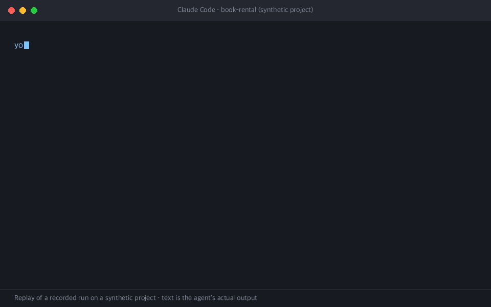

# Code Understanding Coach

An agent skill that checks how well you understand **your current codebase** — by asking
you one question at a time about real behavior, grading your answer against the actual
code with `file:line` evidence, and re-checking the idea in a different situation when
something was missed.

Useful when an AI agent wrote much of your code and you want to know what you can
actually predict about it — before you ship it, maintain it, or explain it to someone.

[한국어 README](README.ko.md)



<sub>Replay of a recorded run (Claude Code, synthetic project in `tests/fixtures/book-rental`).
The text is the agent's actual output; only formatting was simplified.</sub>

## What it does

- **"Check my understanding of this project"** → covers the main features, structure, and
  data flow, one area at a time.
- **"Quiz me on the login flow"** → focuses on that feature and everything it touches:
  entry points, calls, state, storage, error handling.
- Asks **one question**, waits for your answer, then tells you what you got right and what
  you missed — with the lines that prove it.
- Questions ask you to **predict behavior in a concrete situation and explain why**, not to
  recall function names or constants. It is open book: read the code while you answer.
- Answers are graded **understood / partial / misconception / undetermined**. Wording does
  not matter; a wrong mental model does. No numeric score.
- After a miss (or "I don't know"), it explains and asks about the **same idea in a
  different situation**. Repeating its explanation back does not count.
- Every three questions it asks whether to continue. Say "stop" any time to get a summary
  of what was covered, what was not, and what to revisit.

It reads code only. It does not edit files, run your code, or run Git commands, and it does
not save anything.

## Install

### With the skills CLI (recommended)

```sh
# Current project, for the agents you choose
npx skills add <owner>/code-understanding-coach

# All your projects
npx skills add <owner>/code-understanding-coach -g

# Pick agents explicitly, no prompts
npx skills add <owner>/code-understanding-coach -a claude-code codex -y
```

[`skills`](https://github.com/vercel-labs/skills) is the open-source skills CLI from
Vercel Labs (not an Anthropic or OpenAI tool) and needs Node.js. It finds the skill in this
repository's `skills/` folder and installs it into `.claude/skills/` (Claude Code) and
`.agents/skills/` (Codex), or the `~/` equivalents with `-g`. By default it keeps one copy
in `.agents/skills/` and symlinks it for Claude Code (pass `--copy` for separate copies),
and records the install in a `skills-lock.json` file in your project.

Then, in your project, ask: *"Check my understanding of this project"* or *"Quiz me on
\<feature\>"*. You can also invoke it explicitly with `/code-understanding-coach` (Claude
Code) or `$code-understanding-coach` (Codex).

### Manually

The skill is one folder, `skills/code-understanding-coach/`. Copy it into your agent's
skills directory.

```sh
git clone https://github.com/<owner>/code-understanding-coach.git
```

| Agent | All your projects | One project |
|---|---|---|
| Claude Code | `~/.claude/skills/` | `<project>/.claude/skills/` |
| Codex | `~/.agents/skills/` | `<project>/.agents/skills/` |

```sh
# Claude Code, all projects
mkdir -p ~/.claude/skills
cp -R code-understanding-coach/skills/code-understanding-coach ~/.claude/skills/

# Codex, all projects
mkdir -p ~/.agents/skills
cp -R code-understanding-coach/skills/code-understanding-coach ~/.agents/skills/
```

Claude Code and Codex read different directories, so install into each agent you use.

### Update

- skills CLI: `npx skills update` (add `-g` for global installs). `npx skills check` lists
  available updates.
- Manual: `git pull` in your clone, then copy the folder again.

### Uninstall

- skills CLI: `npx skills remove code-understanding-coach` (add `-g` for global installs).
- Manual: delete the copied `code-understanding-coach` folder from the skills directory.
- Codex can also disable it without deleting: add a `[[skills.config]]` entry with
  `enabled = false` to `~/.codex/config.toml` and restart Codex.

## Supported environments

| Agent | Status |
|---|---|
| Claude Code (tested with 2.1.310) | **Tested** — 15 conversation scenarios, one run each, on the synthetic project. See [Verification](#verification) |
| Codex CLI | **Not yet verified.** The skill uses only standard Agent Skills fields and Codex documents the same format, but no scenario run has passed yet |
| Other agents, claude.ai | Not tested |

The skill follows the [Agent Skills specification](https://agentskills.io/specification)
(only `name`, `description`, `license` in the frontmatter).

## Limits

- **The same assistant asks and grades.** It settles the minimum answer before asking and
  does not show it, but it cannot be hidden the way a separate grader could. If you ask it
  for the answer, it explains — and records the concept as "after explanation".
- **Read-only is an instruction, not a sandbox.** Neither agent offers a portable way for a
  skill to block write tools. Use your agent's permission settings if you need a guarantee.
- **It samples.** A whole-project check covers a few areas well; it does not certify that
  you understand everything. The summary lists what was not covered.
- **Large repositories** are explored per question, so only part of the code is read.
- **Model output varies.** The same answer can occasionally get a different verdict.
- **Cost** is whatever your agent's usage costs; the skill adds no separate service.
- One scenario is not tested yet: the assistant asking a question with a false premise and
  you pointing it out (it needs a hand-made conversation).

## Privacy

The skill sends nothing anywhere by itself. Your code and answers go only to the coding
agent you are already using, under that agent's terms. It does not open `.env` files, keys,
or credential stores, and does not write records.

## Prior art

Inspired by [Sphinx](https://github.com/parthh01/sphinx) (MIT), which checks your
understanding of a change when you `git push`, using a separate evaluator model.
This project borrows assessment ideas — commit to a minimum answer before asking, re-check
the question before grading, ask a transfer question after a miss, treat code and answers
as untrusted data — but no code or text, and works differently:

| | Sphinx | Code Understanding Coach |
|---|---|---|
| Starts | Git hook on push/commit | You ask, in plain language |
| Scope | The change being pushed | The current code: whole project or one feature |
| Grader | Separate model via CLI or API | The agent you are talking to |
| Interface | Browser page or terminal | Your agent conversation |
| Install | npm package, hooks, config | Copy one folder |

## Verification

This repository has no runtime code, so verification is about behavior:

```sh
python3 scripts/check.py        # spec frontmatter, file references, personal-info scan
python3 tests/scenarios/run.py --agent claude --scenario all --jobs 4   # real model calls
```

`tests/scenarios/` replays multi-turn conversations against an agent on a synthetic project,
with a simulated developer answering correctly, partially, or wrongly. A script checks that
the skill triggered, that nothing was written or executed, and that a planted secret never
leaked; a human checks question and grading quality with
[`CHECKLIST.md`](tests/scenarios/CHECKLIST.md). See
[`tests/scenarios/README.md`](tests/scenarios/README.md).

Design notes and the recorded results live in [`docs/plans/initial-skill/`](docs/plans/initial-skill/).

## License

[MIT](LICENSE)
